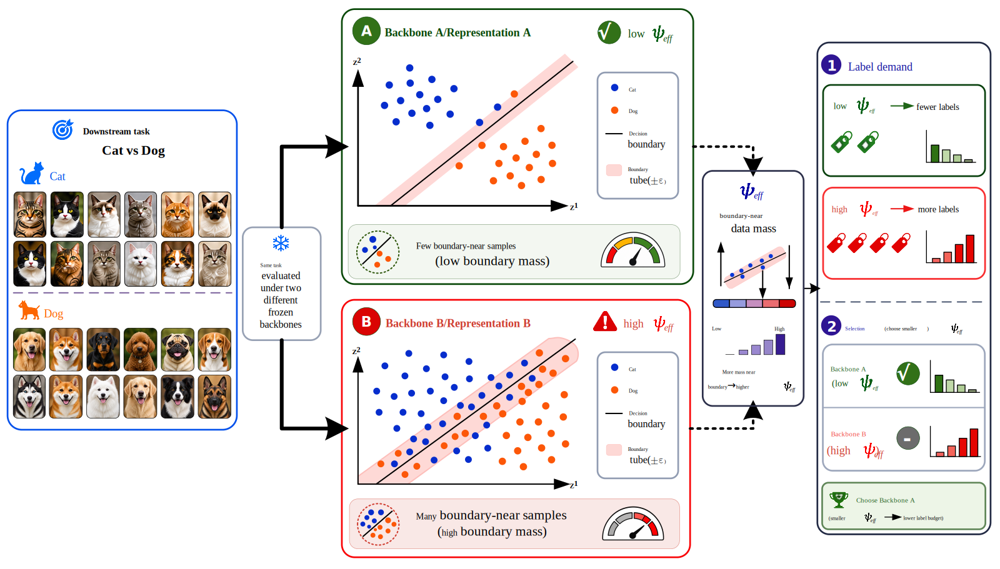
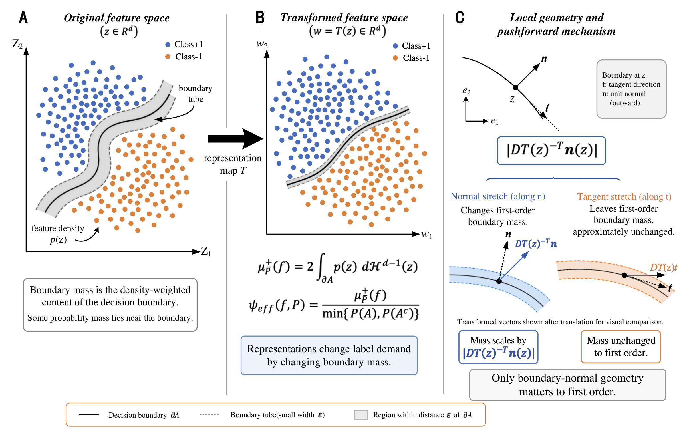
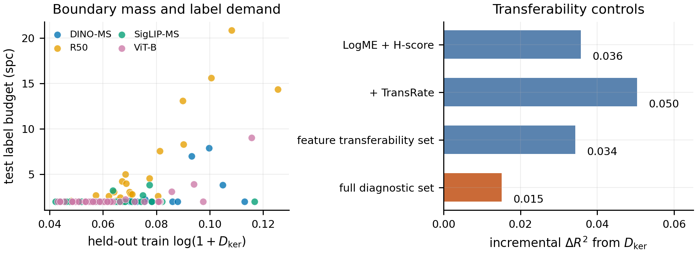

<div align="center">

# BoundaryMass

**Boundary Mass in Feature Space as a Label-Budget Diagnostic for Representations**

Siming Zhang* · Zhehui Shen* · Shijie Chen · Yansen Yu · Hang Yu  
Shanghai University · *Equal contribution

[](#getting-started)
[](LICENSE)

[Code](https://github.com/qqaqq-code/boundary_mass) · [Introduction](#introduction) · [Getting Started](#getting-started) · [Usage](#usage) · [Results](#results) · [Experiments](docs/EXPERIMENTS.md)

</div>

<a id="introduction"></a>
## 📖 Introduction



**BoundaryMass** measures feature concentration near the decision boundary of a fitted downstream probe. It connects local geometry to label demand and supports second-stage selection among strong pretrained representations.

- **Geometry:** the pushforward law describes boundary-mass changes through the local boundary-normal direction.
- **Measurement:** a fitted linear head turns features into signed distances and boundary-tube weights.
- **Selection:** conventional diagnostics produce a shortlist, and boundary mass compares its remaining local ambiguity.

### How it works

1. Fit feature standardization and a linear probe on the probe-training split.
2. Compute signed distances on independent diagnostic features while keeping the probe fixed.
3. Normalize tube membership by tube width and predicted-class balance.
4. Compare candidates in the conventional top-2 shortlist.



<a id="getting-started"></a>
## ✨ Getting Started

```bash
cd boundarymass
python3 -m venv .venv
source .venv/bin/activate
pip install -r requirements.txt
python demo.py
```

The demo fits a linear separator to the bundled two-dimensional example and writes a figure to `outputs/figures/`.

For feature extraction and training:

```bash
conda env create -f environment.yml
conda activate boundarymass
```

[Data preparation](docs/DATA.md) covers the datasets, feature extraction, and input formats.

<a id="usage"></a>
## 🔧 Usage

### Estimate boundary mass

For standardized diagnostic features `Z`, a fitted binary head `(w, b)`, and a positive tube width `epsilon`:

```python
import numpy as np
from utils.boundary import estimate_boundary_mass

signed_distance = (Z @ w + b) / np.linalg.norm(w)
psi_hat = estimate_boundary_mass(signed_distance, epsilon)
psi_kernel = estimate_boundary_mass(signed_distance, epsilon, kernel="gaussian")
```

Use a fitted head with a positive normal norm and diagnostic samples covering both predicted classes. Binary scoring costs **O(Nd)**; C-class OvR scoring costs **O(NCd)**. Both estimates use the two-sided boundary coefficient and predicted-class balance. The [experiment guide](docs/EXPERIMENTS.md#boundary-mass-estimation) describes kernel and tube estimation, class normalization, and label-budget experiments.

### Synthetic geometry

```bash
python run.py pushforward -- --n-samples 5000 --orientation-points 5
python run.py sample_complexity
```

### Backbone selection

After feature preparation, use a shared output directory for dependent experiments:

```bash
python run.py backbone_selection --output-dir outputs/selection
python run.py transferability --output-dir outputs/selection
python run.py tiny_imagenet --output-dir outputs/selection
python run.py near_tie_selection --output-dir outputs/selection
```

### Multiclass, acquisition and refitting

```bash
python run.py multiclass_comparison
python run.py acquisition --output-dir outputs/selection
python run.py pilot_refitting --output-dir outputs/selection
```

The [experiment guide](docs/EXPERIMENTS.md) describes settings, inputs, outputs, and additional entry points.

<a id="results"></a>
## 📊 Results

### Geometry and backbone selection

| Experiment | Result |
|---|---|
| Pushforward law, 74 transformations | 0.38% median relative error |
| Normal scaling, scale 1 → 2 | −1.54 samples per class |
| Tangent control, scale 1 → 2 | +0.02 samples per class |
| Conventional selection → top-2 boundary-mass rule | 0.058 → 0.030 mean regret |
| Adding boundary mass to conventional + transferability regression | R² 0.734 → 0.749 |



### Multiclass estimator agreement

40 five-way Tiny-ImageNet tasks, four backbones, and five splits, using shared semantic class identities across backbones.

| Comparison | Spearman ↑ | Pairwise concordance ↑ | Selected-backbone agreement ↑ |
|---|---:|---:|---:|
| Hard OvR vs. Hard Interface | 0.872 | 90.0% | 89.5% |
| Smooth OvR vs. Smooth Interface | 0.868 | 89.7% | 89.5% |

### Label acquisition

40 CIFAR-100 binary tasks, four backbones, and five seeds, initialized with two labels per class. The target is 95% of each task's best full-probe accuracy. Spearman correlation is computed across the 160 task–backbone pairs after averaging the five seeds.

| Policy | Budget ↓ | Spearman ↑ | Regret ↓ |
|---|---:|---:|---:|
| Random | 7.05 | 0.779 | 1.08 |
| Uncertainty | 5.57 | 0.830 | 0.58 |
| Hybrid | 5.47 | 0.824 | 0.42 |

Budgets and regrets use samples per class. Across five pilot-label draws, the combined boundary-mass policy achieves **91.5–92.0% selected-budget agreement**.

## 🗂️ Project Structure

```text
boundarymass/
├── README.md
├── LICENSE
├── requirements.txt
├── requirements-train.txt
├── environment.yml
├── demo.py
├── run.py
├── extract_features.py
├── train_cifar100_probe.py
├── train_imagefolder_probe.py
├── train_encoder.py
├── train_end_to_end.py
├── plot_results.py
├── experiments/                 # Experiment implementations
├── utils/                       # Metrics and shared numerical routines
├── configs/                     # Experiment and model settings
├── examples/                    # Two-dimensional example
├── figures/                     # Method and result figures
└── docs/                        # Data preparation and usage
```

## 🌻 Acknowledgements

This work uses CIFAR-100, Tiny-ImageNet, PyTorch, and pretrained ResNet, ViT, DINO, and SigLIP models. We thank the dataset and model authors for their contributions.

Code is distributed under the [MIT License](LICENSE). Contact: [Hang Yu](mailto:yuhang@shu.edu.cn).
